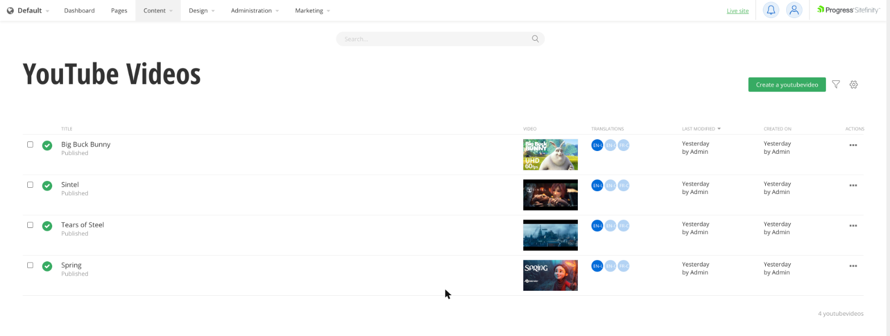
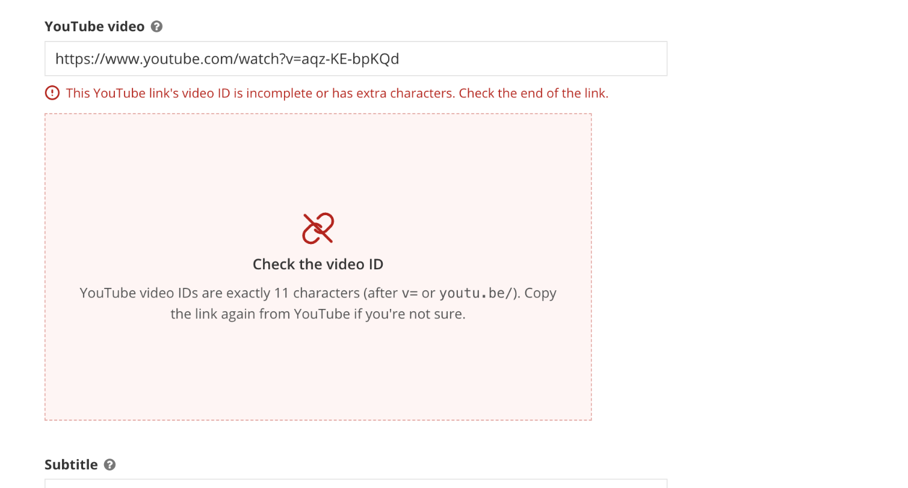
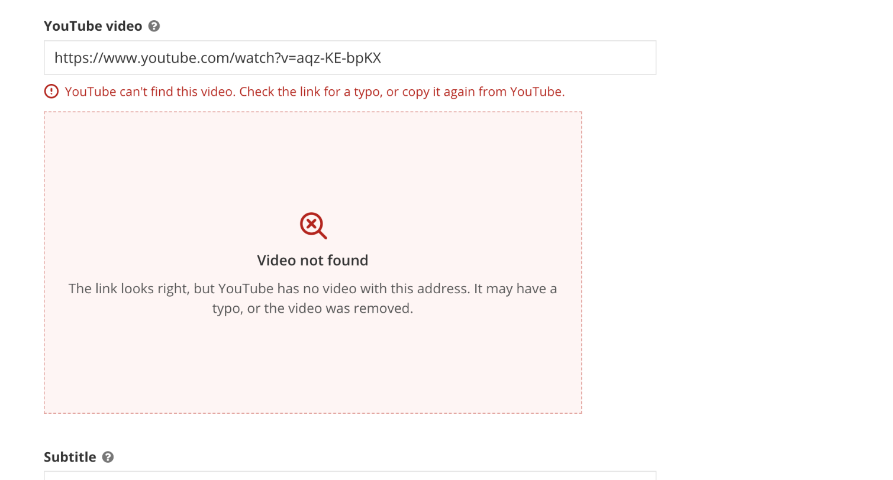

# sitefinity-youtube-field

A Sitefinity AdminApp extension for content types that store a YouTube link.

- **Edit screen:** editors paste a link, and the field shows the video playing right underneath, plus its title from YouTube.
- **Content list:** gets a thumbnail column, so every row shows its video at a glance.

It works on any content type, built-in or Module Builder, that has a short-text field with a matching name. Nothing is hard-coded to a particular module.



## Quick start

1. **Add the field.** In Administration > Module Builder, open your module's content type and add a **Short text** field named `YouTubeUrl` (or `VideoUrl`). Existing built-in types such as News work too: add the field as a custom field.
2. **Install the bundle.** Either download [`youtube-field.extensions.bundle.js`](https://github.com/sitefinitysteve/sitefinity-youtube-field/releases/latest) and copy it into your site's `AdminApp/` folder (next to `index.html`), or run:
   ```bash
   npx sitefinity-youtube-field install path/to/YourSite/AdminApp
   ```
3. **Restart the site.** Sitefinity caches extension bundles until the application restarts. Recycle the app pool, or save any change to `web.config`.
4. **Hard-refresh the backend** (Ctrl+F5), open the content type and paste a YouTube link into the field.

That's all the setup there is; there are no settings to fill in. To change field names or limit which types it applies to, see [Configuration](#configuration).

## What it does

### In the edit screen

Editors paste a YouTube link in any form, and the field cleans it up:

| Pasted | Saved |
|---|---|
| `https://www.youtube.com/watch?v=dQw4w9WgXcQ&list=PL…&si=…` | `https://www.youtube.com/watch?v=dQw4w9WgXcQ` |
| `https://youtu.be/dQw4w9WgXcQ?t=90` | `https://www.youtube.com/watch?v=dQw4w9WgXcQ&t=90s` |
| `<iframe src="https://www.youtube.com/embed/dQw4w9WgXcQ?si=…" …></iframe>` | `https://www.youtube.com/watch?v=dQw4w9WgXcQ` |
| `youtube.com/shorts/…`, `/live/…`, `youtube-nocookie.com/embed/…`, `m.youtube.com`, a bare 11-character id | `https://www.youtube.com/watch?v=…` |

The field always stores one standard link: `https://www.youtube.com/watch?v=ID`, plus `&t=Ns` when the pasted link had a start time. Your front-end code only ever has to handle that one format.


- **Pasted embed code:** the field keeps just the link, and tells the editor it did ("Embed code detected - saved just the video link.").
- **Preview:** a player shows the video under the field while the editor works, along with "✓ Found on YouTube: *title*".
- **Problems:** a broken link gets a clear panel in place of the preview. The panels and what each one does to saving:

| Panel | When it shows | Saving |
|---|---|---|
| No video in this link | The text isn't a YouTube link | Blocked |
| Check the video ID | A YouTube link whose ID is cut short or has extra characters | Blocked |
| Video not found | YouTube says the video doesn't exist (a typo, or it was removed) | Blocked; switch off with `blockMissingVideos` |
| Can't be embedded | The video is private or embedding is turned off | Allowed, with a warning |

 

- **Read-only view:** locked items and users without edit rights see the thumbnail and the link.

### In the content list

A **Video** column shows each item's thumbnail. If the type also has a related image field named `CustomThumbnail` or `Thumbnail`, that image is shown instead of YouTube's, so the backend list matches what your site shows.

## Requirements

- Sitefinity with the Angular AdminApp backend. This was built with the 15.3 AdminApp SDK and tested on **Sitefinity 15.4 (15.4.8636)**.
- Node 20+ only if you install through npm or build from source. The prebuilt bundle needs nothing.

## Install

Sitefinity loads every `*.extensions.bundle.js` it finds in the site's `AdminApp/` folder. Installing this extension means putting one file there. There's no web.config entry and no database change.

### Option 1: download the bundle

1. Download `youtube-field.extensions.bundle.js` from the [latest release](../../releases/latest), or from [`release/`](release/) in this repository.
2. Copy it into your site's `AdminApp/` folder, next to `index.html`.
3. Restart the site, then hard-refresh the browser (Ctrl+F5).

### Option 2: npm

```bash
npm install --save-dev sitefinity-youtube-field
```

```bash
npx sitefinity-youtube-field install path/to/YourSite/AdminApp
```

`install` accepts the web app root too: it finds `AdminApp/` inside it.
- `--config` also copies the settings file (see [Configuration](#configuration)).
- `uninstall` removes both files.
- `path` prints where the bundle sits inside `node_modules`.

Pinning the version in `package.json` keeps the extension's version in source control. Running the install as a build step stops a Sitefinity upgrade, or an AdminApp restore from NuGet, from deleting a hand-copied file:

```json
{
  "scripts": {
    "postbuild": "sitefinity-youtube-field install ./YourSite/AdminApp"
  }
}
```

In an MSBuild or PowerShell build, run the same command after the step that restores `AdminApp/`.

### Option 3: build it yourself

```bash
git clone https://github.com/sitefinitysteve/sitefinity-youtube-field.git
cd sitefinity-youtube-field
npm install
npm run build:release
```

That runs the tests, builds a production bundle and writes `release/youtube-field.extensions.bundle.js`.

### After installing: restart the site, then hard-refresh

Sitefinity caches extension bundles until the site restarts, and browsers cache them too. After installing or upgrading:
1. Restart the site.
2. Hard-refresh the browser (Ctrl+F5). Every editor needs to do this once.

On a development machine you can turn the server cache off:

```xml
<appSettings>
  <add key="sf:DisableAdminAppExtensionsCache" value="true" />
</appSettings>
```

## Set up a content type

Any content type works. In Module Builder (Administration > Module Builder):

1. Add a **Short text** field named `YouTubeUrl`, or `VideoUrl`, `YouTubeVideoUrl`, `YouTubeLink`. Making it required is a good idea.
2. Optionally, add a **Related media > Image** field named `CustomThumbnail`, single image. When an item has one, the list column shows it instead of YouTube's thumbnail.

Built-in types work the same way. Add a custom short-text field with one of those names to News, Events, Blog posts and so on.

## Configuration

The defaults should suit most sites. To change them:

1. Copy [`config/youtube-field.config.extensions.bundle.js`](config/youtube-field.config.extensions.bundle.js) into `AdminApp/` next to the bundle, or run `npx sitefinity-youtube-field install <AdminApp> --config`.
2. Edit it.
3. Restart the site.

It sets one global:

```js
window.SitefinityYouTubeField = {
    fieldNames: ["YouTubeUrl", "YouTubeVideoUrl", "YouTubeLink", "VideoUrl"],
    types: [],
    widgetDesigners: false,
    thumbnailFieldNames: ["CustomThumbnail", "Thumbnail"],
    listColumn: true,
    columnTitle: "Video",
    columnOrdinal: 50,
    checkVideoExists: true,
    blockMissingVideos: true,
    debug: false
};
```

| Setting | Default | What it does |
|---|---|---|
| `fieldNames` | `["YouTubeUrl", "YouTubeVideoUrl", "YouTubeLink", "VideoUrl"]` | Short-text fields that get the YouTube editor, on any content type. The editor matches case-insensitively. The list column looks the names up in OData, so spell them as Sitefinity does (for example `VideoUrl`, not `videourl`). |
| `types` | `[]` (every type) | Limit to some content types by set name (`"videos"`, `"newsitems"`) or full type name (`"Telerik.Sitefinity.DynamicTypes.Model.Videos.Video"`). `*` is a wildcard. The edit screen only knows the set name, so use set names if you want both the editor and the column limited. |
| `widgetDesigners` | `false` | Also use the editor on matching properties in widget designers (`typeName` `widget-<Name>`). |
| `thumbnailFieldNames` | `["CustomThumbnail", "Thumbnail"]` | Related-image fields whose image replaces YouTube's in the list column. The first one the type has is used. `[]` always uses YouTube's thumbnail. |
| `listColumn` | `true` | Add the thumbnail column to content lists. |
| `columnTitle` | `"Video"` | The column header. |
| `columnOrdinal` | `50` | The column's position. Sitefinity spaces its own columns by 100, and 50 puts this one right after the title. |
| `checkVideoExists` | `true` | Ask YouTube whether the video exists and show its title. When `false`, the player just loads the link. |
| `blockMissingVideos` | `true` | Block saving when YouTube says the video doesn't exist. |
| `debug` | `false` | Log every field, list and thumbnail lookup to the browser console. Use it to find a type's set name and field names. |

Missing or invalid settings fall back to their defaults. The settings are read each time they're needed, so it doesn't matter which file loads first.

## How the matching works

- **Edit screen:** for every field it draws, the AdminApp asks extensions whether they want to replace it. It passes the field name, the field type and the content type's set name. This extension takes short-text fields whose name is in `fieldNames`, on a type allowed by `types`. It leaves every other field alone.
- **Content list:** the AdminApp doesn't tell extensions which fields a type has. The first time a list of each type opens, the extension asks the OData service, `GET /sf/system/<set>?$top=0&$select=<field>`, for each name in `fieldNames` until one works.
  - **Thumbnail field:** if a name works, it checks the `thumbnailFieldNames` the same way, using `$expand`.
  - **Result:** the answer is kept for the rest of the session. Types without a matching field get no column.
  - **What you'll see:** that first check can show up as one or two `400` responses in the browser's network tab. That's the expected answer for "no such field".

## Showing the video on your site

The stored value is a plain standard watch URL. That makes the embed address easy to build on the server:

```csharp
// "https://www.youtube.com/watch?v=dQw4w9WgXcQ&t=90s" -> "https://www.youtube-nocookie.com/embed/dQw4w9WgXcQ?start=90"
var uri = new Uri(item.GetValue<object>("YouTubeUrl").ToString());
var query = HttpUtility.ParseQueryString(uri.Query);
var id = query["v"];
var start = (query["t"] ?? "").TrimEnd('s');
var embed = $"https://www.youtube-nocookie.com/embed/{id}" + (start.Length > 0 ? $"?start={start}" : "");
var thumbnail = $"https://i.ytimg.com/vi/{id}/hqdefault.jpg";
```

## Content Security Policy

If your site sends a Content-Security-Policy for the backend (Administration > Settings > Web security), allow:

| Directive | Source | Why |
|---|---|---|
| `frame-src` | `https://www.youtube-nocookie.com` | the preview player |
| `img-src` | `https://i.ytimg.com` | thumbnails |
| `connect-src` | `https://www.youtube.com` | the "does this video exist" check (oEmbed) |

## Privacy

The existence check calls YouTube's public oEmbed endpoint (`https://www.youtube.com/oembed?url=…`) from the editor's browser, without cookies. The preview uses `youtube-nocookie.com`. Nothing else leaves your site. Set `checkVideoExists: false` to skip the oEmbed call.

## Troubleshooting

| Symptom | Fix |
|---|---|
| Nothing changes after installing | Restart the site, then hard-refresh (Ctrl+F5). Make sure the file is directly in `AdminApp/`, not in a subfolder. Open `/admin-bridge/extensions` and search it for `sitefinity-youtube-field`. |
| The editor shows up but the list column doesn't | The list check needs the exact field spelling. Turn on `debug`, open the list and read the `[youtube-field] list:` lines. |
| A field I didn't mean is using the editor | Its name is in `fieldNames`. Narrow `fieldNames`, or limit `types`. |
| All the backend extensions stopped working | A JavaScript error in any `*.extensions.bundle.js` breaks all of them, because Sitefinity concatenates them. Check the console's first red line, and the syntax of the settings file. |
| "Video not found" for a video that exists | The video may be very new, or YouTube's oEmbed may be unreachable from the editor's network. Set `blockMissingVideos: false` to allow saving anyway. |

## Development

```bash
npm install
npm test               # parser and settings tests (node:test, no browser)
npm start              # AdminApp dev server on http://localhost:3000 (see Progress's kit docs for pointing it at a site)
npm run build:release  # tests + production bundle -> release/
```

| Path | Contents |
|---|---|
| `src/youtube/youtube.ts` | Link parsing and cleanup (pure functions, unit tested) |
| `src/youtube/config.ts` | Settings, defaults and matching (unit tested) |
| `src/youtube/youtube-url-write.component.*` | The edit field: cleanup, preview, YouTube check, error panels |
| `src/youtube/youtube-url-readonly.component.ts` | Read-only view |
| `src/youtube/youtube-thumbnail-cell.component.ts` | List thumbnail cell |
| `src/youtube/youtube.providers.ts` | Field and column registration |
| `build/` | The build setup from Progress's [AdminApp extensions kit](https://github.com/Sitefinity/sitefinity-admin-app-extensions), unmodified apart from `publish-bundle.js` |

To publish a new version:
1. Bump `version` in `package.json` and add a `CHANGELOG.md` entry.
2. Commit, then tag `vX.Y.Z` and push the tag.

The GitHub workflow builds the bundle and attaches it to a GitHub release. It also publishes to npm when an `NPM_TOKEN` secret is set.

## License

The extension's own code (`src/`, `tests/`, `bin/`, `config/`, `build/publish-bundle.js`) is [MIT](LICENSE).

The rest of `build/`, plus `angular.json`, comes from Progress's Sitefinity AdminApp extensions kit. It's covered by Progress's sample-code license ([`build/PROGRESS-SAMPLE-EULA.md`](build/PROGRESS-SAMPLE-EULA.md)) and is only used to build the bundle.

Sitefinity is a trademark of Progress Software Corporation, and YouTube is a trademark of Google LLC. This project isn't affiliated with or endorsed by either company.
